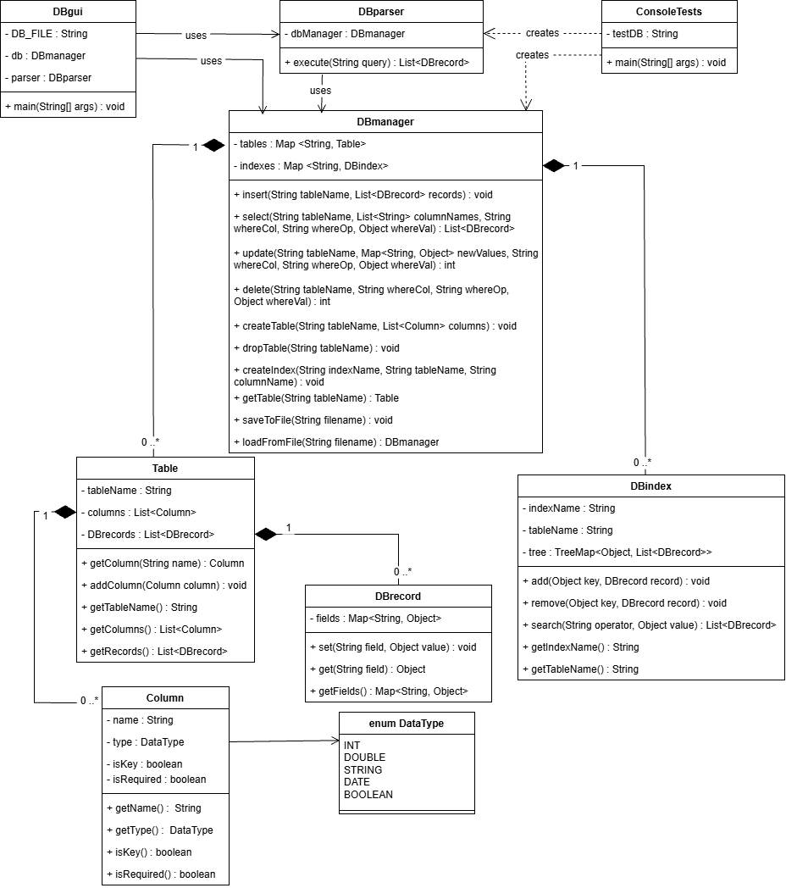
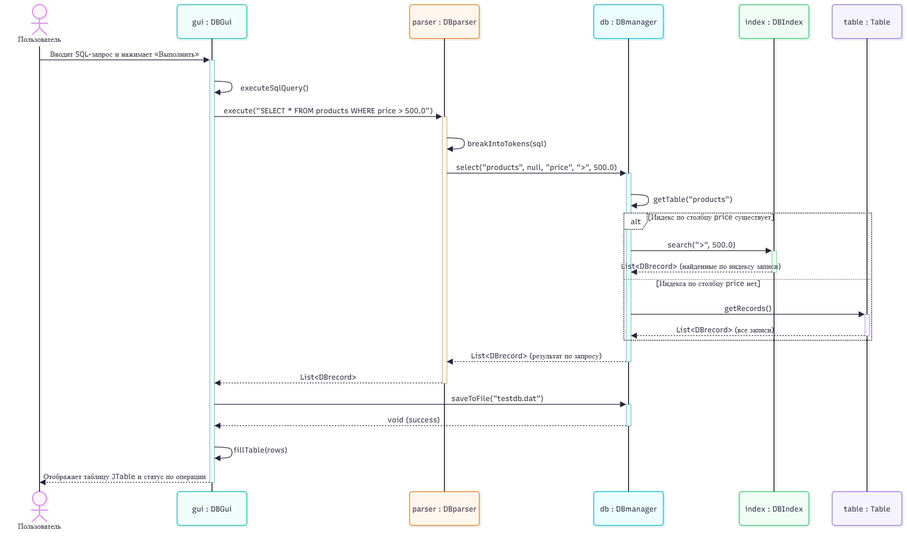
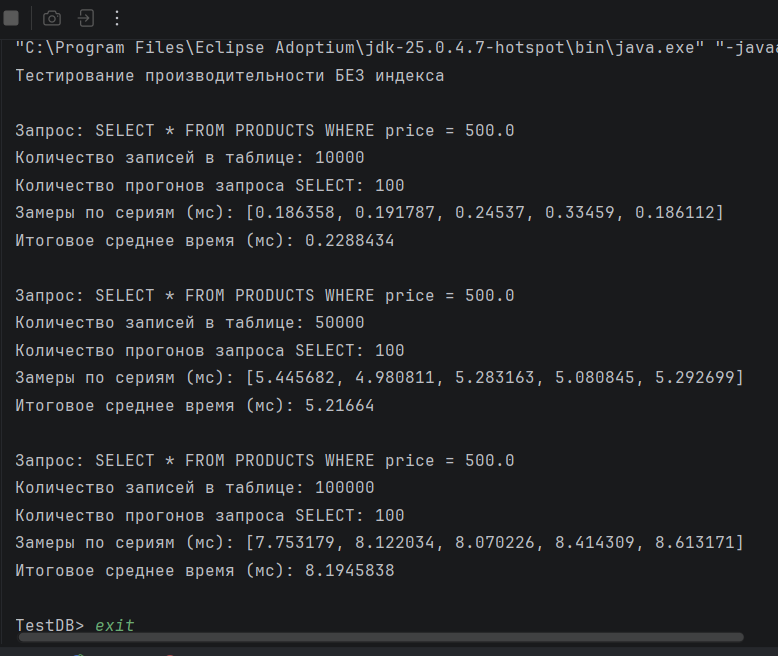
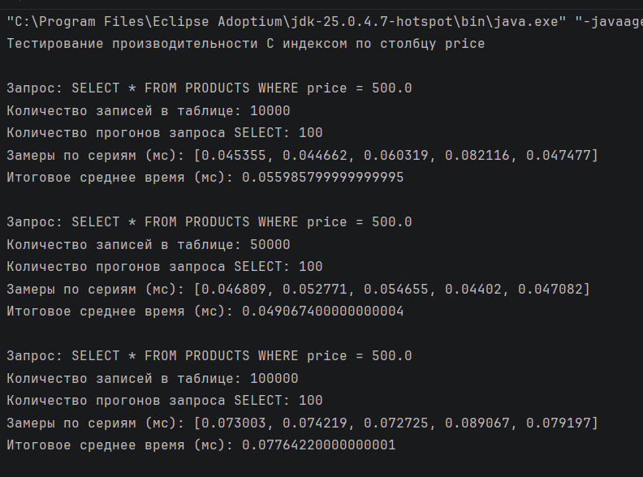

## Предметная область и схема данных

В работе взята предметная область **учета товаров и складов торговой сети**. Связь между таблицами организована по принципу «один-ко-многим»: один склад может хранить множество партий товаров.

### Таблица `warehouses` (Склады)

Таблица складов, являющаяся родительской по отношению к таблице товаров:

* `id : INT` *(Primary Key, NOT NULL)* — уникальный идентификатор склада.
* `address : STRING` *(NOT NULL)* — фактический адрес расположения склада (например, `'ул. Большая Покровская, 10'`).
* `isFull : BOOL` — флаг заполненности склада (`TRUE` - склад заполнен, `FALSE` - есть свободные места, допускает значение `NULL`).

### Таблица `products` (Товары)

Хранит сведения о партиях товаров и их привязку к складам через внешний ключ `warehouseId`:

* `id : INT` *(Primary Key, NOT NULL)* — уникальный артикул/идентификатор товара.
* `name : STRING` *(NOT NULL)* — наименование товара (например, `'Свитер вязаный'`).
* `price : DOUBLE` *(NOT NULL)* — цена за единицу товара (разделитель дробной части — точка).
* `manufactureDate : DATE` — дата изготовления товара в стандартном формате `YYYY-MM-DD` (необязательное поле, допускает `NULL`).
* `quantity : INT` *(NOT NULL)* — количество единиц товара на складе.
* `warehouseId : INT` *(Foreign Key, NOT NULL)* — внешний ключ, ссылающийся на поле `id` в таблице `warehouses`.
---
## Архитектура системы и описание классов

Программа разделяет слои пользовательского интерфейса, парсера, менеджера управления данными и моделью хранения:

* **DBgui** — графический интерфейс пользователя на базе библиотеки **Java Swing** (`JFrame`, `JTable`, `JTextArea`). Обеспечивает ввод SQL-запросов, табличное отображение результатов выборки `SELECT`, автосохранение базы данных на диск после каждой операции и при закрытии окна, а также перехват исключений с выводом диагностических сообщений в многострочную панель статуса.
* **ConsoleTests** — точка входа для проведения тестов. Содержит генератор тестовых наборов данных заданного объёма (`createTestDatabase`) и модуль замеров скорости выполнения запросов (`testSelect`.
* **DBparser** — лексический и синтаксический анализатор пользовательского ввода. Разбивает входную строку на токены с учётом строковых литералов в одинарных кавычках и составных операторов сравнения (`>=`, `<=`, `!=`),
проверяет синтаксис SQL-команд (`SELECT`, `INSERT`, `UPDATE`, `DELETE`, `CREATE TABLE`, `DROP TABLE`, `CREATE INDEX`), привязывает строковые значения к целевым типам данных и передаёт инструкции в `DBmanager`.
* **DBmanager** — центральный менеджер базы данных, реализующий интерфейс `Serializable`. Хранит словарь таблиц и словарь построенных индексов, отвечает за инициализацию базовой схемы (`warehouses`, `products`), выполнение CRUD-операций,
контроль целостности (проверка типов, уникальность `PRIMARY KEY`, обязательность `NOT NULL`, ссылочная целостность внешнего ключа `warehouseId`), синхронизацию индексов при изменении данных, а также сериализацию и десериализацию всей БД в бинарный файл.
* **DBIndex** — компонент индексирования на основе TreeMap (`TreeMap<Object, List<DBrecord>>`), реализующий `Serializable`. Обеспечивает быстрый поиск записей по точному совпадению (`=`) и по диапазонам (`>`, `>=`, `<`, `<=`) за логарифмическое время $O(\log N)$, а также автоматическое обновление узлов дерева при добавлении, изменении или удалении записей.
* **Table** — модель реляционной таблицы (`Serializable`). Инкапсулирует имя таблицы, схему столбцов (`List<Column>`) и коллекцию хранимых строк (`List<DBrecord>`), предоставляя методы поиска столбцов без учёта регистра и управления записями.
* **Column** — модель метаданных столбца таблицы (`Serializable`). Описывает имя столбца, тип данных (`DataType`) и флаги ограничений целостности (`isKey` для первичного ключа и `isRequired` для обязательных полей `NOT NULL`).
* **DataType** — перечисление (`enum`) поддерживаемых типов данных СУБД: `INT`, `DOUBLE`, `STRING`, `DATE`, `BOOL`.
* **DBrecord** — модель отдельной строки (записи) таблицы (`Serializable`). Хранит пары «имя столбца - значение» в коллекции `LinkedHashMap<String, Object>`, что гарантирует сохранение исходного порядка столбцов при отображении результатов выборки.

### Диаграмма классов


## Принцип работы системы

### Диаграмма последовательностей


1. **Инициализация и загрузка (DBgui и DBmanager)**: при запуске программа проверяет наличие файла базы данных (`workdb.dat`).
Если файл найден, состояние всех таблиц, записей и индексов восстанавливается через сериализацию Java по умолчанию. Если файла нет - инициализируется новая БД с двумя базовыми связанными таблицами: `warehouses` (склады) и `products` (товары).

2. **Разбор запросов (DBparser)**: введенная пользователем строка разбивается на части (токены). 
Парсер проверяет синтаксис команды, определяет ее тип и передает список строк, полученный из запроса, менеджеру БД.
3. **Выполнение и контроль целостности (DBmanager)**: Здесь проверяется существование таблиц и столбцов,
соответствие типов данных (`INT`, `DOUBLE`, `STRING`, `DATE`, `BOOL`), уникальность первичных ключей (`PRIMARY KEY`), 
заполненность обязательных полей (`NOT NULL`) и ссылочную целостность по внешнему ключу. 
Также здесь реализованы все функции работы с БД (`INSERT`, `SELECT`, `UPDATE`, `DELETE`, `CREATE TABLE`, `DROP TABLE`,`CREATE INDEX`).
4. **Индексирование (DBIndex)**: при выполнении `CREATE INDEX` строится индекс на базе `TreeMap`, который ускоряет поиск по точному совпадению (`=`) и диапазонам (`>`, `<`, `>=`, `<=`). Индексы автоматически синхронизируются при любых операциях `INSERT`, `UPDATE`, `DELETE` и `DROP TABLE`.
5. **Сохранение и вывод**: после каждой успешной модификации данные сохраняются на диск. Результаты `SELECT` отображаются в графической таблице `JTable`. Также после каждой операции выводится статус ее выполнения (все успешно выполнилось или перехватилась ошибка).
---
## Результаты тестирования производительности

### Методика проведения замеров
Для количественной оценки эффективности индексирования на базе `TreeMap` был проведён сравнительный эксперимент по замеру времени выполнения одного и того же поискового запроса:

```sql
SELECT * FROM products WHERE price = 500.0;
```

Тестирование проводилось на трёх синтетических наборах данных объёмом **10 000**, **50 000** и **100 000** записей (где целевому значению `price = 500.0` соответствовала группа из 500 записей). Чтобы исключить искажения, связанные с работой виртуальной машины Java (JVM) и операционной системы, применялась следующая методика:

1. **Таймер `System.nanoTime()`**: использовался для измерения чистых интервалов времени выполнения метода выборки в памяти без учёта затрат на отрисовку таблицы в консоли.
2. **Предварительный прогрев JVM (1000 «разгоночных» прогонов)**: перед включением таймера целевой запрос выполнялся 1000 раз вхолостую. Это необходимо для того, чтобы JIT-компилятор (Just-In-Time) полностью скомпилировал «горячий» байт-код в оптимизированный машинный код до начала замеров.
3. **Усреднение по 5 сериям из 100 прогонов**: для каждого объёма данных выполнялось 5 независимых серий по 100 последовательных вызовов `SELECT` (итого 500 замеряемых запросов на каждую точку). Время каждой серии делилось на 100, после чего вычислялось итоговое среднее по массиву из 5 серий — это позволило сгладить случайные фоновые скачки нагрузки процессора ОС.

### Тесты без индекса


### Тесты с индексом


### Анализ изменения времени выполнения
* **Линейный рост без индекса — $O(N)$**: при отсутствии индекса система выполняет полный последовательный перебор всех записей таблицы. При увеличении объёма данных в 10 раз (с 10 000 до 100 000 строк) среднее время выполнения запроса выросло в **36 раз** (с `0.228 мс` до `8.190 мс`).
* **Стабильное время с индексом — $O(\log N)$**: после создания индекса `CREATE INDEX idx_products_price ON products (price)` поиск целевого ключа выполняется по `TreeMap`. Даже при десятикратном росте таблицы (до 100 000 записей) время выборки осталось практически постоянным (на уровне `0.045–0.087 мс`), обеспечив ускорение поиска примерно в **94–115 раз** на больших объёмах данных.
---
## Инструкция по запуску
### Требования
* **Java Development Kit (JDK):** версия 8 или выше.

### Вариант 1: Сборка и запуск из консоли (терминала)

1. **Клонируйте репозиторий на локальный компьютер и перейдите в папку проекта:**

2. **Создайте директорию для скомпилированных файлов и выполните компиляцию всех исходников с указанием кодировки UTF-8:**
   ```bash
   mkdir -p out
   javac -encoding UTF-8 -d out src/*.java src/model/*.java
   ```
3. **Запустите нужный режим работы приложения:**
    * **Запуск графического интерфейса (Java Swing):**
      ```bash
      java -cp out DBgui
      ```
    * **Запуск тестов производительности:**
      ```bash
      java -cp out ConsoleTests
      ```

### Вариант 2: Запуск через IntelliJ IDEA
1. Откройте папку проекта в IntelliJ IDEA.
2. **Для запуска графического интерфейса:** запустите метод `main` в файле `src/DBgui.java`. Чтобы выйти, нужно нажать на крестик в правом верхнем углу окна
3. **Для запуска тестов производительности с индексом и без него:** откройте файл `src/ConsoleTests.java` и запустите его метод `main`.

## Демонстрация работы и поддерживаемые SQL-команды

Ниже приведён полный сценарий работы с базой данных с нуля, демонстрирующий все поддерживаемые операции, типы данных и проверки целостности.

> **Примечание:** При первом запуске базовые таблицы `warehouses` и `products` инициализируются автоматически. Строковые значения и даты заключаются в одинарные кавычки `'...'`, регистр ключевых слов не влияет на выполнение запроса.

### 1. Добавление данных (`INSERT INTO`)

#### Добавление складов

**Добавление одной записи со всеми полями:**
```sql
INSERT INTO warehouses VALUES (1, 'ул. Большая Покровская, 10', FALSE);
```

**Добавление записи с частичным набором полей** (необязательное поле `isFull` автоматически заполняется значением `NULL`):
```sql
INSERT INTO warehouses (id, address) VALUES (2, 'пр. Гагарина, 25');
```

#### Добавление товаров

**Важно:** Поле `warehouseId` ссылается на идентификатор склада из таблицы `warehouses`. Попытка добавить товар с несуществующим `warehouseId` (например, `5`) приведёт к ошибке нарушения ссылочной целостности.

**Добавление одной записи со всеми полями:**
```sql
INSERT INTO products VALUES (1, 'Митенки', 750.0, '2026-10-01', 15, 2);
```

**Добавление нескольких записей за один запрос:**
```sql
INSERT INTO products VALUES 
    (2, 'Ноутбук', 75000.0, '2026-05-10', 5, 1),
    (3, 'Свитер', 7500.0, NULL, 10, 2);
```

**Добавление записи с частичным набором полей:**
```sql
INSERT INTO products (id, name, price, quantity, warehouseId) VALUES (4, 'Монитор', 25000.0, 8, 2);
```

**Примечание:** Обязательные поля (`NOT NULL`) и первичный ключ (`id`) должны быть заполнены; значение первичного ключа должно быть уникальным.

---

### 2. Просмотр и поиск данных (`SELECT`)

* **Вывести все товары со всеми столбцами:**
  ```sql
  SELECT * FROM products;
  ```
* **Вывести только названия и цены товаров (определенные столбцы):**
  ```sql
  SELECT name, price FROM products;
  ```
* **Точный поиск по значению (`=`):**
  ```sql
  SELECT * FROM products WHERE price = 7500.0;
  ```
* **Поиск с неравенством (`!=`):**
  ```sql
  SELECT * FROM products WHERE warehouseId != 1;
  ```
* **Диапазонный поиск по числам (`>`, `>=`, `<`):**
  ```sql
  SELECT * FROM products WHERE price > 10000.0;
  SELECT * FROM products WHERE price >= 25000.0;
  SELECT * FROM products WHERE quantity < 10;
  ```
* **Фильтрация по дате (`<=`):**
  ```sql
  SELECT * FROM products WHERE manufactureDate <= '2026-06-01';
  ```

---

### 3. Обновление данных (`UPDATE`)

* **Изменить цену и количество конкретного товара:**
  ```sql
  UPDATE products SET price = 30000.0, quantity = 12 WHERE id = 4;
  ```
* **Перевести товар на другой существующий склад:**
  ```sql
  UPDATE products SET warehouseId = 1 WHERE id = 3;
  ```
* **Очистить значение необязательного поля (установить `NULL`):**
  ```sql
  UPDATE products SET manufactureDate = NULL WHERE id = 1;
  ```
* **Массовое обновление всех записей в таблице (без секции `WHERE`):**
  ```sql
  UPDATE warehouses SET isFull = FALSE;
  ```

**Примечание:** Изменение первичного ключа (`id`) с помощью команды `UPDATE` запрещено.

---

### 4. Создание индексов (`CREATE INDEX`)

Для ускорения поисковых запросов в оперативной памяти можно создавать индексы на базе красно-чёрного дерева (`TreeMap`):

* **Создание индекса по столбцу `price`:**
  ```sql
  CREATE INDEX idx_products_price ON products (price);
  ```
* После создания индекс автоматически задействуется при точечном поиске (`=`) и выборке по диапазонам (`>`, `>=`, `<`, `<=`):
  ```sql
  SELECT * FROM products WHERE price = 750.0;
  SELECT * FROM products WHERE price > 5000.0;
  ```
* При последующих операциях `INSERT`, `UPDATE`,`DELETE` и `DROP TABLE` дерево индекса синхронизируется автоматически.

---

### 5. Удаление данных (`DELETE`)

* **Удалить конкретный товар по идентификатору:**
  ```sql
  DELETE FROM products WHERE id = 4;
  ```
* **Удаление склада:** Склад можно удалить только если к нему не привязан ни один товар в таблице `products`:
    1. Убедитесь, что на складе нет товаров (или удалите/перенесите их):
       ```sql
       SELECT * FROM products WHERE warehouseId = 2;
       ```
    2. Если связанных товаров нет, можно выполнить удаление:
       ```sql
       DELETE FROM warehouses WHERE id = 2;
       ```

---

### 6. Создание и удаление пользовательских таблиц (`CREATE TABLE`, `DROP TABLE`)

Система позволяет создавать новые таблицы с указанием типов данных (`INT`, `DOUBLE`, `STRING`, `DATE`, `BOOL`) и ограничений (`PRIMARY KEY`, `NOT NULL`), а также удалять их вместе со связанными индексами:

```sql
-- Создание новой таблицы магазинов
CREATE TABLE shops (id INT PRIMARY KEY, title STRING NOT NULL, isOpen BOOL);

-- Заполнение и просмотр таблицы
INSERT INTO shops VALUES (1, 'Небо', TRUE), (2, 'Фантастика', FALSE);
SELECT * FROM shops;

-- Удаление пользовательской таблицы
DROP TABLE shops;
```

**Примечание:** Из-за наличия внешнего ключа удаление родительской таблицы `warehouses` (`DROP TABLE warehouses`) заблокировано, пока в системе существует зависимая таблица `products`.

### 7. Примеры запросов с проверкой обработки ошибок

При нарушении синтаксиса или ограничений целостности система перехватывает исключение и выводит диагностическое сообщение в панель статуса (без аварийного завершения работы):

```sql
-- 1. Нарушение уникальности первичного ключа (PRIMARY KEY)
INSERT INTO products VALUES (1, 'Дубликат', 100.0, NULL, 1, 1);

-- 2. Пропуск обязательного поля (NOT NULL)
INSERT INTO products (id, name, price, warehouseId) VALUES (10, 'Без количества', 100.0, 1);

-- 3. Нарушение внешнего ключа (несуществующий склад id = 5)
INSERT INTO products VALUES (10, 'Товар на несуществующий склад', 100.0, NULL, 1, 5);
UPDATE products SET warehouseId = 5 WHERE id = 1;

-- 4. Запрет удаления используемого склада и родительской таблицы
DELETE FROM warehouses WHERE id = 1;
DROP TABLE warehouses;

-- 5. Запрет изменения первичного ключа
UPDATE products SET id = 999 WHERE id = 1;

-- 6. Несоответствие типов данных и формата даты
INSERT INTO products VALUES (10, 'Неверная цена', 'дорого', NULL, 1, 1);
INSERT INTO products VALUES (10, 'Неверная дата', 100.0, '15.11.2026', 1, 1);

-- 7. Обращение к несуществующей таблице или столбцу
SELECT * FROM unknown_table;
SELECT * FROM products WHERE unknown_column = 10;

-- 8. Синтаксическая ошибка в запросе
SELECT * FROM products WHERE price ~ 100;
```


---
## Выводы и источники
В ходе выполнения лабораторной работы была спроектирована и реализована упрощённая реляционная СУБД на языке Java с поддержкой графического интерфейса (`Java Swing`) и автоматического сохранения состояния на диск через механизм бинарной сериализации (`Serializable`).

Применение коллекций Java (`HashMap`, `LinkedHashMap`, `ArrayList`) позволило организовать структурированное хранение таблиц, контроль типов данных и соблюдение ограничений целостности (`PRIMARY KEY`, `NOT NULL`, `Foreign Key`). 
Внедрение вторичных индексов на базе `TreeMap` снизило сложность поисковых запросов с линейной $O(N)$ до логарифмической $O(\log N)$, что на объёме в 50 000–100 000 записей обеспечило ускорение выборки примерно в **94–115 раз** при сохранении практически постоянного времени отклика (менее `0.09 мс`).

### Список использованных источников
#### 1. Лекции курса по Java (4,5,6,8) и по курсу Управление данными (для UML-диаграмм)

#### 2. Разборы `TreeMap` для индексирования
* [Oracle Java SE: Class TreeMap](https://oracle.com) 
* [Baeldung: A Guide to TreeMap in Java](https://baeldung.com)
* [Habr: Как устроено индексирование баз данных](https://habr.com) 

#### 3. Графический интерфейс (Java Swing)
* [Oracle: Creating a GUI With Swing](https://oracle.com)
* [Oracle: How to Use Tables (JTable & DefaultTableModel)](https://oracle.comcomponents/table.html)
* [Oracle: How to Use Text Areas (JTextArea)](https://oracle.comcomponents/textarea.html)
* [Baeldung: Introduction to Java Swing](https://baeldung.com) 

#### 4. Дополнительно
* [Habr: Измеряем скорость кода Java правильно](https://habr.com) 

* [GitHub: Basic writing and formatting syntax (Markdown)](https://github.com) 

